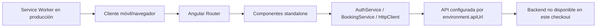

# 01. Arquitectura

## Arquitectura comprobada

`src/main.ts` arranca `AppComponent` con `appConfig`. `src/app/app.config.ts` registra Router, HttpClient con interceptor y Service Worker. La aplicación es standalone; no hay `NgModule`.

## Estructura

- `src/app/components/`: welcome, login, register, dashboard, profile, booking, my-requests y navegación móvil.
- `src/app/services/`: autenticación y una interfaz de reservas.
- `src/app/auth.guard.ts`: protección de rutas.
- `src/app/auth.interceptor.ts`: intento de adjuntar autorización y tratamiento de 401.
- `public/`: manifiesto e iconos PWA.

## Arquitectura planificada

El plan propone POS, PWA, API central, PostgreSQL y Google Calendar. Es una decisión documentada, no una implementación demostrada aquí. El backend debe ser el único componente con acceso a PostgreSQL; la PWA no debe conectarse directamente.

## Flujo de datos observado

1. Un formulario valida localmente.
2. `AuthService` hace POST a `/sidro/login` o `/sidro/register`.
3. El login guarda el token solo en memoria.
4. El interceptor intenta adjuntar el token a URLs bajo `environment.apiUrl`.
5. El dashboard/profile consulta `/sidro/profile`.
6. El flujo de booking consulta servicios, profesionales, disponibilidad y crea solicitudes.

La forma exacta de las respuestas del backend no puede verificarse.

