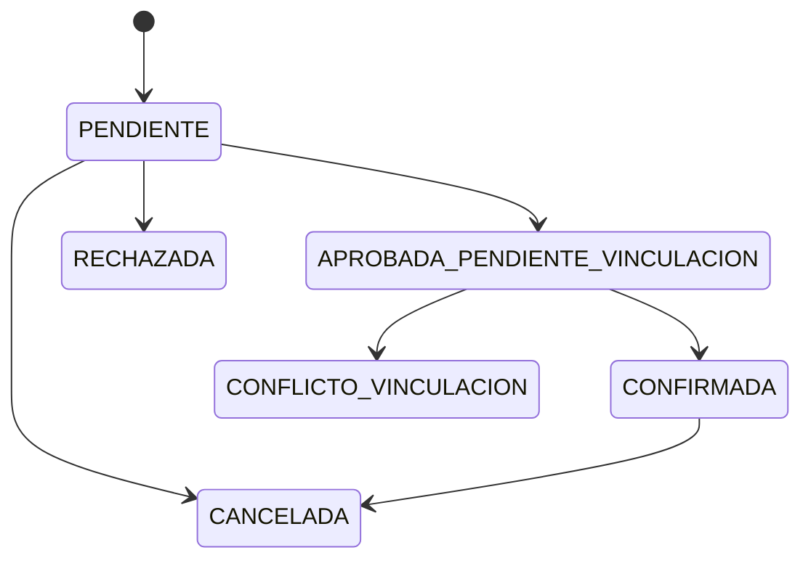

# 04. Reglas de negocio

## Reglas visibles en la PWA

- Teléfono: obligatorio y exactamente 10 dígitos en login/registro.
- Contraseña de registro: obligatoria, mínimo 6 caracteres.
- Nombre: obligatorio, mínimo 3 caracteres.
- Email: opcional, pero debe cumplir `Validators.email` si se informa.
- Una fecha de reserva no puede ser anterior al día calculado por el navegador.
- Una solicitud requiere servicio, profesional, fecha y hora seleccionados.
- Un 401 cierra la sesión y redirige a login; el 403 no desloguea desde el interceptor.

## Estados de solicitudes visibles

La vista `my-requests` reconoce `PENDIENTE`, `APROBADA_PENDIENTE_VINCULACION`, `CONFIRMADA`, `RECHAZADA`, `CANCELADA` y `CONFLICTO_VINCULACION`.

El diagrama representa etiquetas observadas y transiciones plausibles por nombres; el backend no está disponible, así que las transiciones reales son **NO VERIFICADAS**.

## Plan funcional no implementado demostrablemente

OTP, vinculación exclusivamente administrativa, roles profesional/administrador, propuestas alternativas, horarios/descansos, prevención transaccional de conflictos, cancelaciones políticas y Google Calendar aparecen en `masterplandev.md`, pero no en el código accesible.

